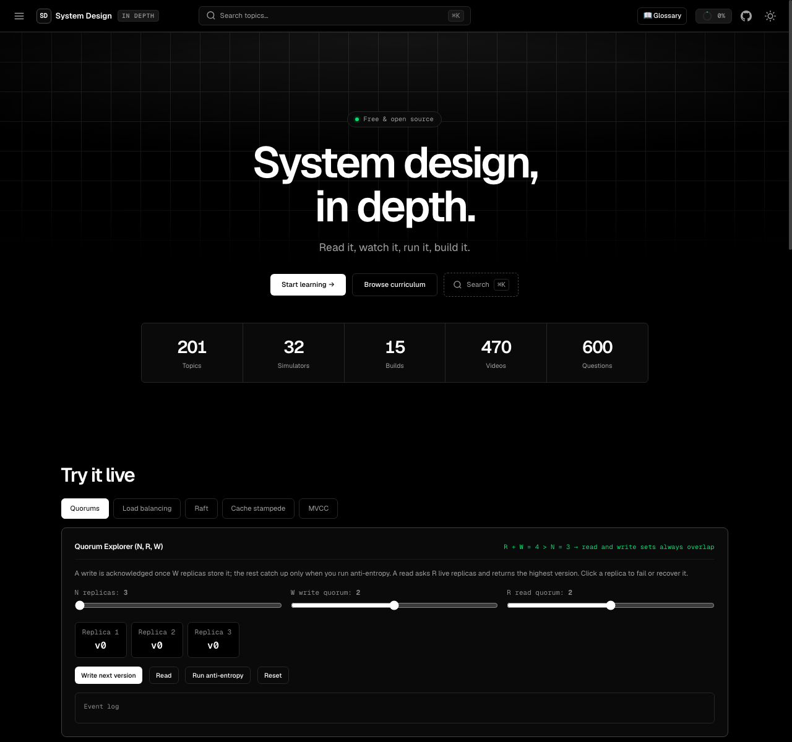

# System Design In Depth

<p align="center">
  <strong>An open-source interactive platform for learning system design, data architectures, and distributed systems engineering from first principles.</strong>
</p>

<p align="center">
  <a href="https://system-design-in-depth.vedgupta.in"></a>
  <a href="https://github.com/innovatorved/system-design-in-depth/actions/workflows/ci.yml"></a>
  <a href="LICENSE#mit-license"></a>
  <a href="LICENSE#creative-commons-attribution-noncommercial-sharealike-40-international"></a>
</p>

<p align="center">
  
  
  
  
  
</p>

<p align="center">
  <a href="https://system-design-in-depth.vedgupta.in"><strong>🚀 Explore the Interactive Platform</strong></a>
</p>

<p align="center">
  <a href="https://system-design-in-depth.vedgupta.in">
    
  </a>
</p>

---

## Why This Exists

Most system design materials are either high-level cheat sheets for interviews or scattered vendor marketing posts. **System Design In Depth** is an intuition-first, dependency-driven engineering curriculum grounded in primary research papers, RFCs, and real-world postmortems — paired with visual sandboxes and from-scratch reference implementations that you can run and verify locally.

- **Zero frameworks, zero build step** — Pure HTML/CSS/JavaScript running statically on any browser or server.
- **Hands-on exploration** — Every abstract theorem is accompanied by a runnable visual simulator or algorithmic build.
- **Deep academic & industry grounding** — 200 architecture diagrams, 469 curated YouTube videos, concrete failure mode breakdowns, and primary literature citations.
- **100% Free & Open Source** — No signup, no paywall, no ads.

---

> **Note:** This project and its embedded browser IDE (`@innovatorved/code-lab`) are in active development.

## Curriculum Overview (6 Tracks, 18 Modules, 200 Units)

The curriculum is structured into **6 core engineering tracks** following strict conceptual prerequisites:

| Track | Scope & Core Concepts | Units | Key Topics |
|---|---|:---:|---|
| **1. Architectural Foundations & Workload Modeling** | Requirements clarification, system invariants, capacity estimation, latency numbers, concurrency runtimes (event loops vs thread pools), monolith-to-microservice boundaries, and hardware economics. | 13 | Back-of-the-envelope calculations, single-core to distributed scaling, latency tiers |
| **2. Data Architecture, Storage Engines & State Persistence** | Relational schemas, indexing internals, B-trees, ACID transactions, locking, MVCC, write-ahead logging (WAL), ARIES recovery, LSM-tree compaction, Bitcask, blob object storage, and sharding keys. | 47 | B-Tree vs LSM write amplification, MVCC isolation anomalies, WAL crash recovery |
| **3. Distributed Systems, Consensus & Coordination** | Network transports (TCP, UDP, gRPC), physical and logical time, replication models, CAP and PACELC trade-offs, Raft consensus, leader election, leases, fencing tokens, and SWIM gossip membership. | 26 | Raft log replication & heartbeat dynamics, quorum (N, R, W) intersection, vector clocks |
| **4. Asynchronous Execution, Queues & Real-Time Processing** | Task queues, event-driven backbones, partitioned logs (Kafka internals), stream processing, probabilistic sketches (HyperLogLog, Count-Min, t-digest), caching tiers, eviction policies, and WebSockets. | 39 | Cache stampede prevention (XFetch), Kafka consumer group rebalancing, streaming state |
| **5. Production Operations, Resilience & System Hardening** | Failure containment, circuit breakers, load shedding, distributed tracing, SLOs and error budgets, zero-downtime database migrations, disaster recovery topologies, geospatial search, and information retrieval. | 49 | Circuit breaker state machines, SLO multi-window burn rates, HNSW embeddings, Geohashing |
| **6. Systems Design Labs & Architectural Evolution** | End-to-end service designs (URL shortener, rate limiters, collaborative editors, chat backends, search engines, video CDNs) and analysis of battle-tested architectures and postmortems (Amazon Dynamo, Discord, Stripe, GitLab). | 26 | Full architectural trade-off matrices, failure-mode trees, real-world postmortem forensics |

---

## Interactive Simulators & From-Scratch Builds

### 32 Interactive Visual Simulators
Interactive sandboxes let you tweak parameters, simulate network partitions, induce race conditions, and watch system invariants hold or fail:
- **Distributed Coordination:** Raft Leader Election, Quorum Explorer (N, R, W), Vector Clocks, Gossip Protocol Spread, CAP Theorem Trade-offs.
- **Storage & Databases:** LSM-Tree vs B-Tree, WAL Crash Recovery, MVCC Snapshot Isolation, Snowflake 64-bit ID Layout.
- **Resilience & Traffic:** Cache Stampede Defense (XFetch), Circuit Breakers, Retry Storms, SLO Burn Rate Alerts, Little's Law Queuing.
- **Algorithms & Data Structures:** Consistent Hashing Ring, Sliding Window Rate Limiter, Cache Eviction (LRU/LFU/FIFO), Bloom Filter, HyperLogLog, Count-Min Sketch, BM25 Scoring, CRDT Conflict Resolution, Geohash Explorer.

### 15 Interactive System Design Build Labs (`/build/<slug>/`)
Each reference implementation runs in the browser at `/build/<slug>/` using **`@innovatorved/code-lab`** ([GitHub](https://github.com/innovatorved/code-lab) · [Docs Wiki](https://github.com/innovatorved/code-lab/wiki) · [npm](https://www.npmjs.com/package/@innovatorved/code-lab)), an in-browser editor and Web Worker Node.js/Bun runtime with guided steps and a sandbox mode:

1. [`/build/load-balancer-from-scratch/`](build/load-balancer-from-scratch/) — Layer 7 Load Balancer (`node:http` reverse proxy, Round-Robin, Least-Connections, P2C, active/passive health checks)
2. [`/build/consistent-hashing-ring/`](build/consistent-hashing-ring/) — Consistent Hashing Ring with Virtual Nodes & Bounded Load
3. [`/build/sliding-window-rate-limiter/`](build/sliding-window-rate-limiter/) — Sliding Window Rate Limiter (Log, Counter, Token Bucket)
4. [`/build/lru-cache/`](build/lru-cache/) — Intrusive Doubly-Linked List + Hash Map LRU Cache
5. [`/build/ttl-cache-reaper/`](build/ttl-cache-reaper/) — TTL Cache with Lazy Expiration & Redis-Style Adaptive Reaper
6. [`/build/bloom-filter-membership/`](build/bloom-filter-membership/) — Kirsch-Mitzenmacher Double-Hashing Bloom Filter
7. [`/build/snowflake-id-generator/`](build/snowflake-id-generator/) — Snowflake 64-bit Time-Ordered ID Generator
8. [`/build/keyset-pagination-cursors/`](build/keyset-pagination-cursors/) — Opaque Keyset (Seek) Pagination Cursors vs SQL `OFFSET`
9. [`/build/write-ahead-log/`](build/write-ahead-log/) — Write-Ahead Log (WAL) with CRC-32 Framing & Torn-Tail Recovery
10. [`/build/lsm-tree-kv-store/`](build/lsm-tree-kv-store/) — LSM-Tree KV Store (WAL, Memtable, Sparse-Indexed SSTables, Compaction)
11. [`/build/lease-leader-election/`](build/lease-leader-election/) — Lease-Based Leader Election with Monotonic Fencing Tokens
12. [`/build/gossip-protocol/`](build/gossip-protocol/) — Push-Pull Anti-Entropy & SWIM Suspicion Failure Detection
13. [`/build/merkle-anti-entropy/`](build/merkle-anti-entropy/) — Merkle-Tree Anti-Entropy Replica Synchronization
14. [`/build/hyperloglog-cardinality/`](build/hyperloglog-cardinality/) — HyperLogLog Cardinality Estimator with Small/Large Range Corrections
15. [`/build/tiny-search-engine/`](build/tiny-search-engine/) — Inverted Index Search Engine with Variable-Byte Posting Lists & BM25F

### `@innovatorved/code-lab`
The interactive build labs run on [`@innovatorved/code-lab`](https://github.com/innovatorved/code-lab) (`v0.1.12`), a standalone browser IDE, public GitHub repository cloner (`git clone`), modular guided lab engine, and Web Worker Node.js/Bun runtime. The embedded labs pin the npm bundle (`0.1.12`) via jsDelivr with an unpkg fallback:
- **[Live Cloud IDE & GitHub Repo Explorer (`code-lab-3dr.pages.dev`)](https://code-lab-3dr.pages.dev)** — Enter any public GitHub repository URL (`owner/repo`) to clone and run it directly in the browser.
- **[GitHub Repository (`innovatorved/code-lab`)](https://github.com/innovatorved/code-lab)** — Source code, issues, and release history.
- **[Documentation Wiki](https://github.com/innovatorved/code-lab/wiki)** — Quick start, workbench configuration, POSIX shell & coreutils, and runtime APIs.
- **[npm Package (`@innovatorved/code-lab`)](https://www.npmjs.com/package/@innovatorved/code-lab)** — Published UMD, ESM, and stylesheet bundles on npm / jsDelivr / unpkg.

---

## Quick Start

This project requires **no npm install, no bundlers, and no compilation**:

```bash
# Clone the repository
git clone https://github.com/innovatorved/system-design-in-depth.git
cd system-design-in-depth

# Serve locally using any static web server
python3 -m http.server 8080
```

Open `http://localhost:8080` in any modern web browser.

---

## Validation & Testing

To run the repository validation checks locally:

```bash
# Validate curriculum structure, schemas, takeaways, and asset stamps
node tools/validate.js
```

The validation suite is continuously executed on every pull request and push to `main` via [GitHub Actions](.github/workflows/ci.yml).

---

## Documentation & Governance

- [Curriculum Dependency Graph](docs/curriculum-dependency-graph.md) — Conceptual prerequisite mapping across all tracks.
- [Primary Source Bibliography](SOURCES.md) — Comprehensive academic research papers, RFCs, and engineering citations.
- [Learning Philosophy](docs/learning-philosophy.md) — Core pedagogical principles and educational methodology.
- [Editorial Policy](docs/editorial-policy.md) — Guidelines for provenance, sourcing, and content verification.
- [Third-Party Notices](THIRD_PARTY_NOTICES.md) — Open-source software licenses and attributions.

---

## Contributing

Contributions are welcome! Please read [CONTRIBUTING.md](CONTRIBUTING.md) for details on code style, content guidelines, running the validator, and cache-busting workflows.

---

## License

This project is dual-licensed:

- **Code, Simulators, Tests & Tooling:** Licensed under the [MIT License](LICENSE#mit-license) © 2024–2026 [Ved Gupta](https://vedgupta.in).
- **Curriculum, Lessons, Guides & Explanatory Content:** Licensed under the [Creative Commons Attribution-NonCommercial-ShareAlike 4.0 International License (CC BY-NC-SA 4.0)](LICENSE#creative-commons-attribution-noncommercial-sharealike-40-international).
