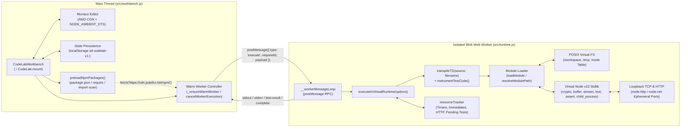

# `@innovatorved/code-lab` — Engineering Specification

`@innovatorved/code-lab` is a zero-dependency browser IDE (`CodeLabWorkbench`) and isolated Virtual Node.js v22 execution engine (`CodeLabRuntime`). It runs identically inside a Web Worker, browser main thread, or Node.js CLI test harness.

---

## 1. System Architecture



| Layer | Source File | Responsibility |
| :--- | :--- | :--- |
| **Workbench UI** | `src/workbench.js` | `<code-lab>` Custom Element, `CodeLab.mount()` SDK, hierarchical folder/file tree explorer with drag-and-drop, decoupled open tabs, Command Palette (`Cmd+Shift+P`), Quick Open (`Cmd+P`), context menus, breadcrumbs, LCS Diff Viewer (`showDiffModal`), and resilient storage (`localStorage` + in-memory fallback). |
| **Worker Host** | `src/runtime.js` | Serializes `__initVirtualRuntime` + `__workerMessageLoop` into an inline `Blob` URL, manages per-instance worker concurrency (`_activeWorkerJobs` + ephemeral worker overflow), and enforces hard watchdog timeouts. |
| **Virtual Runtime** | `src/runtime.js` | Provides `executeInVirtualRuntime`, 10-pass TypeScript/ESM transpiler, CommonJS module loader, POSIX VFS (`node:fs`), 24 built-in modules (`node:console`, `node:net`, `node:http`, etc.), and output flood circuit breakers (`maxOutputBytes`, `maxConsoleCalls`). |

---

## 2. Execution Pipeline

### `executeInWorker(options)` & Multi-Instance Worker Isolation

1. **Self-Contained Worker Serialization**: `createWorkerRuntimeSource()` serializes `__initVirtualRuntime.toString()` and `__workerMessageLoop.toString()` into a `Blob` (`application/javascript`) and caches the object URL in `_cachedWorkerUrl`.
2. **Warm Worker Reuse & Ephemeral Overflow**: `_ensureWarmWorker()` spawns `_warmWorker` on the first run and keeps it alive when idle (`!_warmWorkerBusy`) for sub-millisecond startup. If a second `<code-lab>` instance on the same page executes concurrently while `_warmWorkerBusy` is true, `executeInWorker` transparently spawns an ephemeral `new Worker(_cachedWorkerUrl)` for that job and terminates it upon completion.
3. **Per-Instance Preemption & Cancellation**:
   - Active jobs are tracked in `_activeWorkerJobs` (`Map<jobId, job>`) tagged with `options.instanceId`.
   - Re-running inside a single `<code-lab>` instance or calling `CodeLabRuntime.cancelWorkerExecution(reason, instanceId)` cancels only jobs matching `instanceId` (`{ ok: false, cancelled: true, exitCode: 130 }`), leaving other instances running uninterrupted.
4. **Watchdog Timeout & Output Flood Protection**:
   - `executeInWorker` sets a host-side timer for `(options.timeoutMs || 15000) + 500` ms. If blocked by `while(true)`, the worker is terminated with `{ ok: false, timedOut: true, exitCode: 124 }`.
   - Inside the runtime (and `child_process` subcommands), `stdout`/`stderr` streams enforce `maxOutputBytes` (default `262144` bytes) and `maxConsoleCalls` (default `5000` calls) circuit breakers to prevent memory exhaustion on infinite logging loops.
5. **Fallback**: If `Worker` or `Blob` is unavailable (e.g. Node.js CLI verification), `executeInWorker` falls back directly to `_hostRuntime.executeInVirtualRuntime(options)`.

### `executeInVirtualRuntime(options)` & `resourceTracker` Settle Loop

Inside the runtime, every execution initializes an isolated sandbox (`/workspace` VFS, virtual `process`, virtual `console`, ephemeral port table) and tracks asynchronous resources via `resourceTracker`:

| Tracked Set | Populated By | Cleared By |
| :--- | :--- | :--- |
| `activeTimers` | `sandboxSetTimeout`, `sandboxSetInterval`, `timer.ref()` | Timer callback completion, `clearTimeout`/`clearInterval`, or **`timer.unref()`** |
| `activeImmediates` | `sandboxSetImmediate` | Microtask execution or `clearImmediate` |
| `inFlightHttp` | `vhttp` / `vnet` client-server socket pairs | Response end, socket close, or request error |
| `pendingTests` | Async `test(name, async () => ...)` and `node:test` promise chains | Promise resolution/rejection |

**Event Loop Drain & Cleanup**:
After synchronous entry execution (`loadModule(entryAbs, true)`), the runtime polls in a settle loop until `performance.now() < deadline` (`timeoutMs`, default `30000` ms):
- Awaits two microtask turns (`await Promise.resolve()`), checks if all four `resourceTracker` sets are empty (`!busy`), and increments `idleTicks`.
- Once `idleTicks >= 2` (two consecutive 2 ms ticks with zero active resources), the loop exits cleanly.
- In the `finally` block, `process.emit('exit', exitCode)` fires, all timers in `resourceTracker.allTimers` (including `.unref()` timers) are cleared, and `vhttp.closeAllServers()` + `vnet.closeAllServers()` tear down all listening ports.

---

## 3. 10-Pass TypeScript & ESM Transpiler (`transpileTS`)

`transpileTS(source, filename)` compiles TypeScript and ES Modules into CommonJS in-memory with zero external dependencies.

### Literal & Regex Masking (Pre-Pass)
Before any regex transformation runs, a single-pass lexical scanner masks comments (`//...`, `/*...*/`), string literals (`'...'`, `"..."`), template literals (`` `...` `` with nested `${...}` depth tracking), and regex literals (`/pattern/dgimsuvy` disambiguated from division via `canPrecedeRegex`) into `\x00__LIT_<id>__\x00` tokens stored in `placeholders[]`. All literals are restored in the final step.

### 10 Transformation Passes

| Pass | Syntax Transformed | Output / Behavior |
| :--- | :--- | :--- |
| **1. Ambient & Interface Stripping** | `declare ...`, `interface Foo<T> extends Bar { ... }` | Removed using balanced-brace scanning (`stripBracedBlock`). |
| **2. Enum IIFE Lowering** | `export enum State { Idle, Active = 1, Done = 'DONE' }` | Compiled to bidirectional numeric/string CommonJS IIFE (`State[State["Idle"] = 0] = "Idle"`). |
| **3. Type Aliases & Type Imports** | `type T<U> = ...`, `import type { A } from '...'`, `export type { B }` | Single-line and multi-line braced type aliases and type-only imports/exports stripped. |
| **4. Abstract Classes & Generics** | `abstract class`, `abstract fn(): void;`, `class C<T>`, `function f<T extends Record<string, any>>`, `= async <T>(x) =>` | `abstract` modifiers and balanced `<...>` generic parameter lists removed. |
| **5. Heritage Clauses** | `class A extends B<T> implements C, D {` | `implements ...` clauses and `<T>` type arguments on `extends` stripped. |
| **6. Constructor Parameter Properties** | `constructor(private readonly cap: number, public id = 1)` | Modifiers (`public`, `private`, `protected`, `readonly`, `override`) stripped from params; `this.cap = cap;` injected at the start of the body—or **immediately after `super(...)`** in derived classes. |
| **7. Class Fields & Access Modifiers** | `private count: number;`, `public static async run(): Promise<void>` | Uninitialized typed field declarations removed; field/method modifiers and field `: Type` annotations stripped. |
| **8. Non-Null & Generic Calls** | `expr!`, `new Map<string, Set<number>>()`, `fn<{ a: number }>()` | Non-null `!` assertions and call-site `<...>` type arguments stripped iteratively from inner to outer. |
| **9. Return, Parameter & Variable Types + `as` / `satisfies`** | `): ReturnType =>`, `(a: number, b?: string = 'x')`, `const x: Type =`, `val as const`, `cfg satisfies Config` | Balanced scanner removes return types, parameter types (preserving `= default`), variable types, and `as` / `satisfies` type expressions. |
| **10. ESM-to-CJS Interop** | `import d, { a as b } from 'm'`, `export class X`, `export default`, `export * from` | Rewritten to `require()` and `exports.*` with `__esModule: true` and `module.exports = Object.assign(exports.default, exports)` interop for hybrid CJS/ESM callers. |

---

## 4. Module Resolution & NPM Loader

When user code calls `require(id)` or `import ... from id`, `localRequire` resolves modules in strict priority order:

1. **Built-in Virtual Node.js Modules (`builtinModules`)**:
   Matches bare (`fs`, `http`, `test`) and prefixed (`node:fs`, `node:http`, `node:test`) specifiers:
   `assert`, `assert/strict`, `buffer`, `child_process`, `crypto`, `dns`, `dns/promises`, `events`, `fs`, `fs/promises`, `http`, `https`, `net`, `os`, `path`, `perf_hooks`, `process`, `querystring`, `stream`, `stream/promises`, `string_decoder`, `test`, `timers`, `timers/promises`, `url`, `util`, `zlib`.
2. **Injected Host Packages (`options.packages` / `options.npmModules`)**:
   - **Object / Function values**: Stored in `injectedPackages` (`Map`) and returned directly by `require(pkgName)`.
   - **String values (source code)**: Written into `/workspace/node_modules/<pkgName>/index.js` before execution and loaded via standard VFS module resolution.
3. **Relative & Absolute VFS Paths (`resolveModulePath`)**:
   For `./`, `../`, or `/`, `resolveFileOrDirCandidates(base)` probes:
   - Exact file and extension candidates: `['', '.js', '.ts', '.mjs', '.cjs', '.json']`.
   - Directory `package.json`: Resolves `exports['.']` (`require` -> `import` -> `default` -> `node`), falling back to `main` -> `module` -> `browser`.
   - Directory index files: `['index.js', 'index.ts', 'index.mjs', 'index.cjs', 'index.json']`.
4. **Bare Specifier `node_modules` Walk**:
   Walks up from `fromDir` to `/workspace/node_modules/<pkgName>`. Supports scoped packages (`@scope/pkg/subpath`), `package.json` subpath `exports["./subpath"]`, and file/directory candidates.
5. **Automatic NPM Preloading (`preloadNpmPackages`)**:
   Before worker execution, `preloadNpmPackages(files)` scans `package.json` dependencies plus all `require('...')` and `from '...'` specifiers across workspace files. Any non-builtin bare package not already in VFS or `_npmPackageCache` is fetched from `https://cdn.jsdelivr.net/npm/<pkg>`, cached in `_npmPackageCache`, and mounted at `/workspace/node_modules/<pkg>/index.js`.

---

## 5. Authoring a Guided Lab

Guided labs combine full reference implementations (`data/implementations_code.js` or `options.files`) with step-by-step exercises (`data/guided_labs.js` or `options.guided`).

### How Step Verification & Editor Jump Work
- **Auto-Jump on Step Select**: `selectStep(idx)` opens `step.targetFile` (automatically mapped to `.ts` when `lang === 'ts'`) and searches the Monaco model for `TODO (Step ${idx + 1})` first, then `step.targetSymbol`, centering and highlighting the target line.
- **Test Harness Instrumentation**: `instrumentTestCode(code)` hooks both `node:test` (`describe`/`it`/`test`) and custom `const test = (name, fn) => tests.push({ name, fn });` runners via `__wrapTestFn` and `__shouldSkipTest`.
- **Step Completion**: `runTests()` builds a pass/fail map from `res.testResults`. A step is marked complete when every string in `step.testNames` matches a passing test (`resultMap.get(tName) === true`).

### Minimal Guided Lab Template

```js
const labConfig = {
  id: 'consistent-hashing-ring',
  title: 'Consistent Hashing Ring',
  difficulty: 'Intermediate',
  estimatedMinutes: 25,
  mainFile: 'ring.js',
  tsMainFile: 'ring.ts',

  // 1. Complete passing reference files (used in Sandbox mode & "Reference Solution" modal)
  files: {
    'ring.js': `'use strict';
class HashRing {
  constructor() { this.nodes = new Set(); }
  addNode(node) { this.nodes.add(node); return this.nodes.size; }
}
module.exports = { HashRing };
`,
    'demo.js': `'use strict';
const { HashRing } = require('./ring');
const ring = new HashRing();
console.log('Nodes:', ring.addNode('node-a'));
`,
    'test.js': `'use strict';
const assert = require('node:assert/strict');
const { HashRing } = require('./ring');

const tests = [];
const test = (name, fn) => tests.push({ name, fn });

test('adds a node to the ring', () => {
  const ring = new HashRing();
  assert.equal(ring.addNode('n1'), 1);
});

(async () => {
  for (const t of tests) await t.fn();
})();
`
  },

  // 2. Starter files with TODO (Step N) markers (used in Guided mode)
  starterFiles: {
    'ring.js': `'use strict';
class HashRing {
  constructor() { this.nodes = new Set(); }
  addNode(node) {
    // TODO (Step 1): Add node to this.nodes and return the updated size
    return 0;
  }
}
module.exports = { HashRing };
`
  },

  // 3. Guided steps mapped to exact test('name', fn) strings
  steps: [
    {
      id: 'step-1',
      title: 'Step 1: Register Nodes on the Ring',
      concept: 'Ring Membership',
      instructions: '### Goal\nImplement `HashRing.addNode(node)` to insert `node` into `this.nodes` and return `this.nodes.size`.',
      targetFile: 'ring.js',
      targetSymbol: 'HashRing.addNode',
      hint: 'this.nodes.add(node);\nreturn this.nodes.size;',
      testNames: [
        'adds a node to the ring' // Must match test('<name>', fn) in test.js
      ]
    }
  ]
};
```
